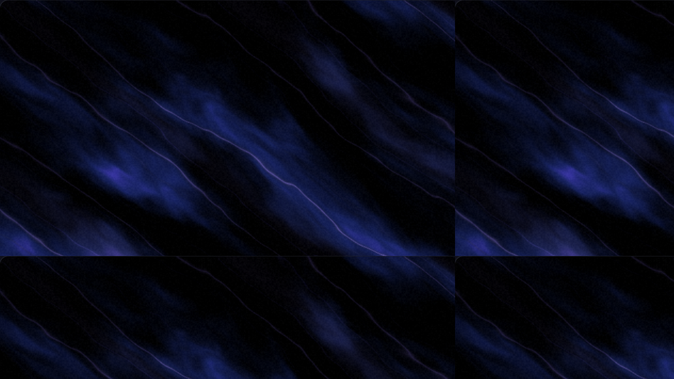
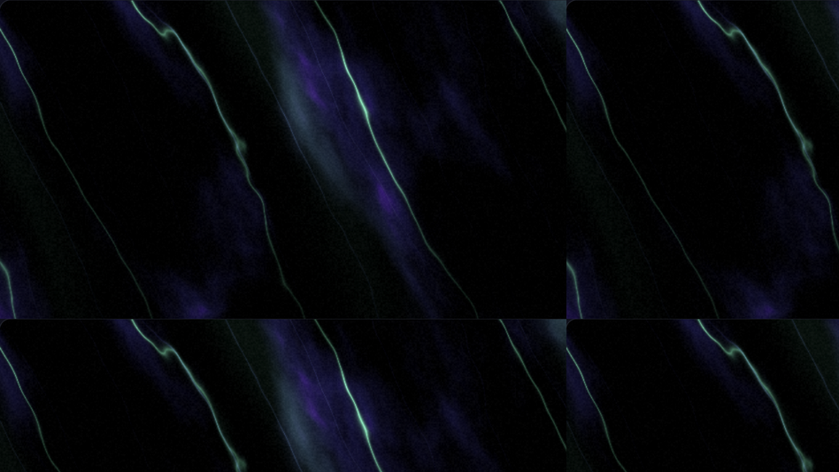
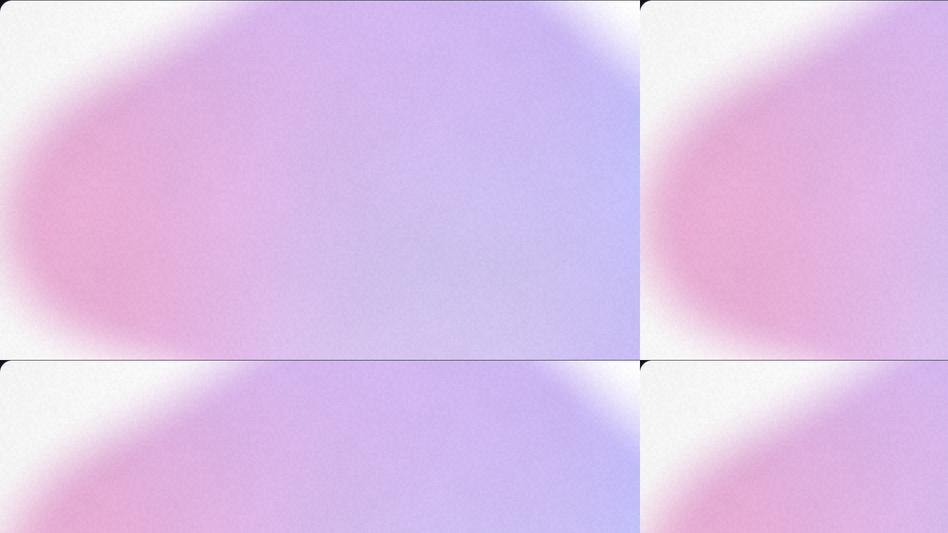

# SpectraWall

**Procedural wallpaper generator** — beautiful silky gradient wallpapers at any resolution, from Full HD to 16K, with a custom size option. Free, open source, runs in the browser on Windows, Linux and macOS.

<p align="center">
  
  
  
</p>

## Features

- **Six generative styles** — Silk waves, Aurora, Soft mesh, Dunes, Nebula (with stars), Neon lines — all GPU-rendered (WebGL2).
- **Any resolution**: FHD / QHD / 4K / 5K / 8K / **16K** (15360×8640), ultrawide, phone sizes, or any custom W×H up to 16384×16384. Export renders in tiles, so huge images work on any GPU.
- **Deterministic seeds**: every wallpaper is defined by a seed string plus parameters. Same seed → identical picture at any resolution, on any OS.
- **Animated wallpapers (v0.2)**: seamlessly looping animation with a live preview. Export as **MP4 (H.264)** or **WebM (VP9)** via WebCodecs, or as a **ZIP of PNG frames** for external encoders. Choose duration (4–60 s), frame rate (24/30/60 fps) and resolution (up to 4K).
- **Detailed controls**:
  - palette: up to 6 colors, editable, lockable, or one-click harmonious random palettes (OKLCH color space);
  - dark / light theme or a custom background color;
  - color coverage — how much of the frame is colored vs background;
  - softness, film grain (strength & size), vignette;
  - advanced (seed-derived, overridable): layers, pattern scale, warp, streaks, intensity.
- **History**: every saved generation is stored locally (IndexedDB) with a thumbnail — reopen, duplicate, tweak, re-export at a different resolution. Import/export the whole collection as JSON.
- **Share links**: the full parameter set is compressed into the URL — send a wallpaper to anyone and they'll see exactly your picture.
- **Presets**: 8 curated built-ins, plus your own saved settings.
- **EN / RU interface**.
- Zero runtime dependencies; production build is ~19 KB gzipped. Works offline after the first load.

## Getting started

```bash
npm install
npm run dev        # development server → http://localhost:5173
```

Production build (static files, host anywhere — GitHub Pages, any static server):

```bash
npm run build      # outputs dist/
npm run preview    # serve dist/ locally
```

Requirements: any browser with WebGL2 (Chrome, Edge, Firefox, Safari 16+). Node.js 18+ for development.
Exporting 8K–16K images is best done in a desktop browser with a few GB of free RAM.

## How rendering works

The wallpaper is a single GLSL fragment shader: a seeded, domain-warped noise flow mapped through your palette, with style-specific structure (anisotropic silk sheets, vertical aurora curtains, gaussian color blobs for the mesh style, stacked rim-lit dune ridges, turbulent nebula clouds with a star field, or wavy neon lines). All coordinates are aspect-normalized, so composition is resolution-independent; film grain is computed in absolute pixels so the grain in preview matches the 16K export exactly. Dithering is applied to eliminate banding on dark gradients.

Export renders the scene in up-to-4096-px tiles (with a uniform pixel offset — seamless by construction) and streams them through a native `CompressionStream`-based PNG encoder — no canvas size limits, no giant memory spikes.

The animation moves the noise field along a **closed circle in noise-time**: frame *i* of *N* samples the field at phase `2π·i/N`, so the last frame flows into the first — every export is a mathematically perfect loop, with no crossfades or seams.

## Roadmap

- [x] **v0.1 — still images**: 3 styles, seeds, palettes, effects, tiled export to 16K, history, share links, EN/RU.
- [x] **v0.2 — animated wallpapers**: seamless loops, live preview, video export — MP4 (WebCodecs), WebM fallback, ZIP of PNG frames.

## Contributing

Issues and pull requests are welcome — see [CONTRIBUTING.md](CONTRIBUTING.md).

## License

[MIT](LICENSE)
